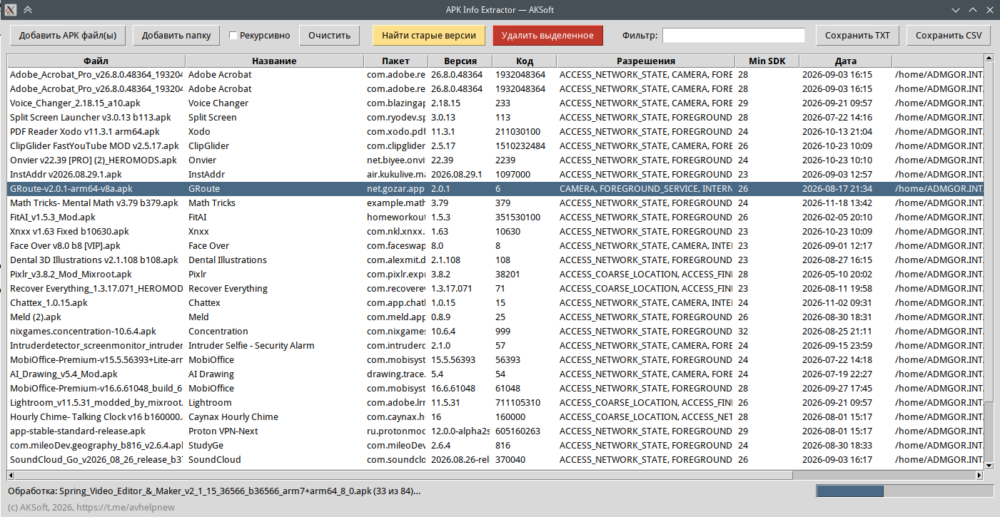

# APK Info Extractor — AKSoft

> Программа для быстрого анализа APK-файлов, поиска дубликатов
> и очистки старых версий приложений.

**© AKSoft, 2026**

- **Telegram:** https://t.me/avhelpnew
- **GitHub:** https://github.com/artemsoft2025
- **E-mail:** koscl@yandex.ru

---

## Описание

Утилита сканирует выбранные APK-файлы (или целые папки) и выводит
в удобную таблицу основную информацию:

- Имя файла и человеческое название приложения
- Имя пакета (package name)
- Версию (version name) и код версии (version code)
- Основные разрешения (что умеет программа)
- Минимальную версию Android (Min SDK)
- Дату изменения файла
- Полный путь к файлу

Программа поставляется в виде готового исполняемого файла.
Установка не требуется — просто распакуйте и запустите.



---

## Основные возможности

1. Добавление отдельных файлов или целых папок с APK.
2. Галочка **«Рекурсивно»** — ищет APK во всех вложенных подпапках.
3. Фильтрация списка по любому столбцу (введите текст в поле **«Фильтр»**).
4. Сортировка по любому столбцу (клик по заголовку).
   - Числовые столбцы (**«Код»**, **«Min SDK»**) сортируются как числа,
     текстовые — по алфавиту без учёта регистра.
   - Повторный клик по тому же заголовку меняет порядок на обратный.
5. Умное выделение строк:
   - Клик по невыделенной строке добавляет её к выделению.
   - Клик по выделенной строке снимает с неё выделение.
   - `Ctrl+клик` и `Shift+клик` работают как в Проводнике.
6. Поиск старых версий: программа группирует файлы по пакету и
   архитектуре (`arm64`, `armv7`, `x86`, `universal` и т.д.) и выделяет
   все версии, кроме самой новой. Вы можете снять выделение с
   нужных файлов (например, TV-версий) и удалить только лишнее.
7. Удаление выделенных файлов:
   - Сначала пытается отправить в **Корзину**.
   - Если не получается (длинный путь, права доступа) — предлагает
     удалить безвозвратно, показав список таких файлов.
8. Контекстное меню (правая кнопка мыши): открыть папку с файлом,
   скопировать название, версию, разрешения, путь или строку целиком.
9. Сохранение текущего отфильтрованного списка в **CSV** или **TXT**.
   CSV сохраняется с разделителем `;` и кодировкой UTF-8 (BOM) —
   корректно открывается в Excel.
10. Статус-бар и прогресс-бар показывают, какой файл обрабатывается
    прямо сейчас. Обработка идёт в фоне, окно не зависает.

---

## Запуск в Windows

1. Распакуйте архив в любую папку.
2. Запустите `APK_Info.exe` двойным щелчком.

Никаких дополнительных компонентов устанавливать не нужно.

> **Примечание:** Windows SmartScreen или антивирус может предупредить о
> запуске неизвестного файла. Это стандартная реакция на программы
> без цифровой подписи. Нажмите **«Подробнее» → «Выполнить в любом
> случае»**.

---

## Запуск в Linux

1. Распакуйте архив в любую папку.
2. Разрешите запуск файла (один раз):

   ```bash
   chmod +x apkinfo_linux
   ```

3. Запустите:

   ```bash
   ./apkinfo_linux
   ```

Или сделайте файл исполняемым через свойства файла в файловом
менеджере и запускайте двойным щелчком.

### Возможные зависимости Linux

Обычно всё необходимое уже встроено в файл программы. Но в
минимальных сборках дистрибутивов может потребоваться доустановить:

- **Поддержка графического интерфейса (Tk/Tkinter):**

  ```bash
  # Ubuntu/Debian
  sudo apt install python3-tk

  # ALT Linux
  su -c "apt-get install python3-module-tk"
  ```

- **Открытие папки по правому клику («Открыть папку с файлом»):**

  ```bash
  # Ubuntu/Debian
  sudo apt install xdg-utils

  # ALT Linux
  su -c "apt-get install xdg-utils"
  ```

- Отправка файлов в **Корзину** в некоторых окружениях рабочего стола
  может быть недоступна. В этом случае программа предложит
  безвозвратное удаление (с обязательным подтверждением).

---

## Использование

1. Нажмите **«Добавить папку»** (или **«Добавить APK файл(ы)»**).
2. Если APK лежат в подпапках — поставьте галочку **«Рекурсивно»**.
3. Дождитесь окончания обработки (смотрите на прогресс-бар внизу).
4. Для поиска дубликатов нажмите **«Найти старые версии»**.
5. Проверьте выделенные строки. Если какие-то файлы удалять не нужно
   (например, версия для ТВ), просто кликните по ним левой кнопкой
   мыши, чтобы снять выделение.
6. Нажмите **«Удалить выделенное»**. Программа спросит подтверждение
   и отправит файлы в **Корзину** (или удалит безвозвратно, если корзина
   недоступна).
7. При необходимости сохраните отчёт кнопками **«Сохранить CSV»** или
   **«Сохранить TXT»**.

---

## Примечания

- Программа **не отправляет данные в интернет**. Всё работает локально.
- Программа ничего не изменяет внутри APK-файлов, **только читает их**.
- Если какой-то файл «битый», защищён паролем или не является APK,
  в таблице появится строка с текстом `ОШИБКА: ...`. Обработка
  остальных файлов при этом не прерывается.
- Название приложения берётся из ресурсов APK. У модифицированных
  сборок оно может отсутствовать — тогда будет показано имя пакета.
- В столбце **«Разрешения»** выводятся только наиболее показательные
  разрешения (интернет, камера, микрофон, контакты, геолокация,
  доступ к памяти и т.п.), а не полный список.
- При удалении файлов, открытых в другой программе (например, в
  архиваторе), система может выдать ошибку доступа. Программа
  покажет список таких файлов.
- Файлы, удалённые безвозвратно, **восстановить невозможно**.

---

## Лицензия

Программа распространяется **«как есть» (AS IS)**. Вы используете её
на свой страх и риск. Автор не несёт ответственности за случайную
потерю данных. Перед массовым удалением всегда проверяйте, что
выделены именно те файлы, которые вы хотите удалить.

---

*(c) AKSoft, 2026 · [https://t.me/avhelpnew](https://t.me/avhelpnew) · [https://github.com/artemsoft2025](https://github.com/artemsoft2025) · koscl@yandex.ru*
